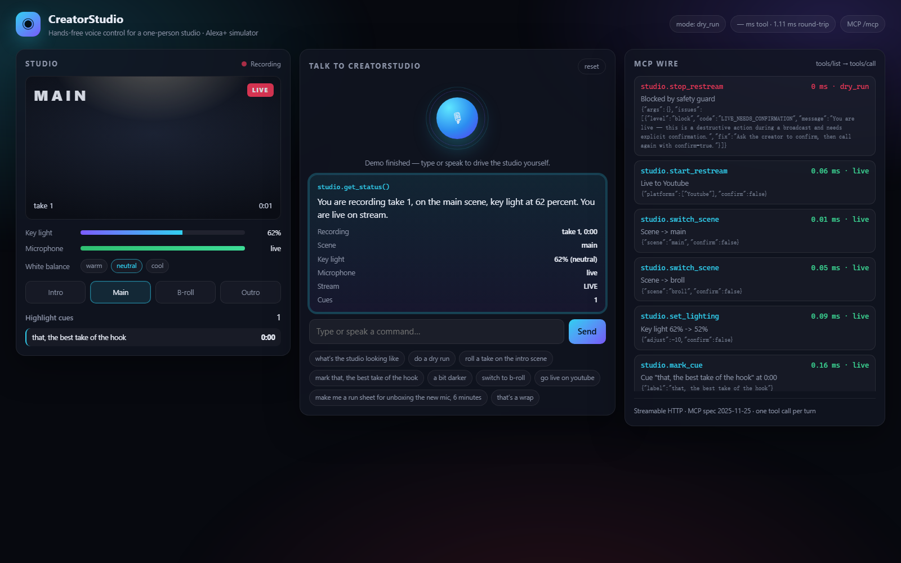

# CreatorStudio: hands-free voice control for a one-person studio

**Track:** Alexa+ · **Mini challenges:** AWS Builder, Open Source · **License:** MIT

> A solo creator is the camera operator, lighting tech, audio engineer, director and streamer all at once.
> If your hands are on the camera (or you are on camera), you cannot click anything.
> CreatorStudio turns a spoken sentence into the exact sequence of studio operations, and **refuses the
> dangerous ones while you are live**.

CreatorStudio is built as an **Alexa+ add-on**: a self-hosted **MCP server** (Model Context Protocol spec
**2025-11-25+**, **Streamable HTTP**) that exposes the studio as 11 well-typed tools, plus an
**Alexa+ simulator web app** so anyone can try the experience without hardware.



---

## Try it in 60 seconds

```bash
npm ci               # or: pnpm install  (the repo ships a lockfile both can use)
npm run dev          # http://localhost:8787
```

> Dependency note: `@modelcontextprotocol/sdk` does **not** declare all of its runtime imports
> (`@hono/node-server`, `content-type`, …), so a strict, isolated `node_modules` (pnpm's default)
> fails at import time. The repo's `.npmrc` pins `node-linker=hoisted`, and `@hono/node-server` and
> `hono` are listed explicitly. This is documented in `docs/FRICTION_LOG.md`.

Then open <http://localhost:8787/> and press one of the suggestion chips
(or hold the mic button and speak, in Chrome/Edge).

Run the test suite and the MCP wire-level smoke test:

```bash
npm test             # 18 unit + in-memory MCP protocol tests
npm run smoke        # speaks MCP over HTTP against a running server
```

## How it maps to Alexa+

| Alexa+ track requirement | Where it lives in this repo |
| --- | --- |
| Self-hosted **MCP server** | `src/mcp/server.ts` — `McpServer` with 11 tools, annotations and an MCP prompt |
| **Streamable HTTP** transport (spec 2025-11-25+) | `src/index.ts` — `StreamableHTTPServerTransport` at `POST /mcp` (stateless) and `/mcp/session` (stateful) |
| Tools actually called in code | `src/core/actions.ts` — every tool is a real function; the simulator and tests call the same code |
| **Simulated Alexa+ experience** | `public/` — voice input (Web Speech API) → intent route → tool call → spoken reply + rich card |
| Low-latency tool round-trips | every tool is synchronous; measured round-trip is single-digit milliseconds (`npm run smoke`) |
| Safety on a voice surface | `src/core/studio.ts` `guard()` — destructive actions on a live stream are blocked unless `confirm: true` |
| **Real hardware, not a mock** | `src/drivers/obs.ts` — OBS Studio over **obs-websocket v5**: `StartRecord`, `StopRecord`, `SetCurrentProgramScene`, with a hard per-call timeout so a frozen OBS can never break the latency budget |

### The tools

| Tool | What it does | Safety |
| --- | --- | --- |
| `studio.get_status` | one-call read of the room (recording, scene, light, mic, stream, cues) | read-only |
| `studio.start_recording` | rolls a take; `dryRun: true` rehearses without rolling | warns if the mic is muted |
| `studio.stop_recording` | saves the take and advances the take counter | needs `confirm` while live |
| `studio.switch_scene` | intro / main / b-roll / outro + the right key light for the shot | needs `confirm` while live |
| `studio.set_lighting` | absolute or relative ("a bit darker") key-light level + warmth | needs `confirm` while live |
| `studio.run_checks` | pre-flight checklist (light, mic, disk, camera) | read-only |
| `studio.mark_cue` | timestamped highlight markers for the editor | warns when not recording |
| `studio.suggest_sections` | topic → timed run sheet | read-only |
| `studio.start_restream` | go live to YouTube/Twitch/… | blocks a second go-live |
| `studio.stop_restream` | end the stream, report the cues collected | needs `confirm` while live |
| `studio.set_microphone` | mute / unmute | — |

Plus the MCP **prompt** `creatorstudio.plan_utterance`, a few-shot router any host model can reuse.

## Architecture

```
              voice utterance
                    │
   ┌────────────────▼────────────────┐        ┌───────────────────────────────┐
   │ Alexa+ (or the simulator page)  │  MCP   │ CreatorStudio MCP server      │
   │  tools/list → tools/call        ├───────►│  Streamable HTTP  /mcp        │
   └────────────────┬────────────────┘        │  11 studio.* tools + 1 prompt │
                    │  spoken reply + card    └──────────────┬────────────────┘
                    ▼                                       │ guard → mutate → journal
              rich responses                          ┌───────▼────────┐
                                                      │ StudioDriver   │──► OBS Studio (obs-websocket v5)
                                                      │ state machine  │    StartRecord / StopRecord /
                                                      └────────────────┘    SetCurrentProgramScene
```

### Real OBS control

OBS Studio ships a WebSocket server (Tools → WebSocket Server Settings → Enable, port 4455).
Point CreatorStudio at it and voice commands reach real hardware:

```bash
STUDIO_MODE=live OBS_URL=ws://127.0.0.1:4455 OBS_PASSWORD=yourpass npm run dev
```

* "roll a take on the intro scene" issues `StartRecord` **and** `SetCurrentProgramScene(Intro)`.
* Driver calls are **dispatched, not awaited** — the spoken reply returns in milliseconds and the
  driver enforces its own timeout (`OBS_TIMEOUT_MS`, default 400 ms), so a frozen OBS can never
  break the Alexa+ latency budget.
* If OBS is unreachable the outcome is logged as `skipped` (`GET /healthz` → `lastOutcome`) and the
  state machine stays consistent.
* No OBS on the demo machine? `npm run obs:stub` starts a fake obs-websocket v5 endpoint
  (`scripts/fake-obs.mjs`). Verified end to end: stub log shows `StartRecord`,
  `SetCurrentProgramScene`, `StopRecord`, and `/healthz` reports `"StopRecord ok", "skipped":false`.

* **`src/core/`** — pure domain logic (state, guard, tool implementations, intent router). No I/O, so all of it
  is unit tested.
* **`src/mcp/`** — the MCP surface. Speech lives in `content`, structured payloads (cards) in `structuredContent`.
* **`src/index.ts`** — HTTP host: MCP endpoints, a small JSON API for the simulator, static UI.
* **`public/`** — the Alexa+ simulator (no build step, no framework).

### Dry run by default

`STUDIO_MODE=dry_run` (the default) journals what *would* happen without touching hardware;
`STUDIO_MODE=live` applies it. A mis-heard word should never take a studio off air.

## Configuration

| Env var | Default | Meaning |
| --- | --- | --- |
| `PORT` | `8787` | HTTP port |
| `OBS_URL` | unset | e.g. `ws://127.0.0.1:4455` — enables the real OBS driver |
| `OBS_PASSWORD` | unset | obs-websocket password |
| `OBS_TIMEOUT_MS` | `400` | hard per-call timeout for OBS |
| `STUDIO_MODE` | `dry_run` | `dry_run` or `live` |
| `PUBLIC_DIR` | auto | override the static UI directory |
| `ALLOW_ORIGIN` | `*` | CORS origin for the simulator / MCP hosts |

## Deploy

**Render / Railway / Fly (Node server):** build `npm ci && npm run build`, start `npm start`.
`GET /healthz` is the health check. The MCP endpoint is then `https://<your-host>/mcp`.

**Local tunnel for the Alexa+ console:** `npx localtunnel --port 8787` (or ngrok) and register
`https://<tunnel>/mcp` as a Streamable HTTP MCP endpoint with no auth for the demo, or bearer auth via
`STUDIO_TOKEN` in production.

**Claude Desktop / any MCP client (stdio-free):**

```json
{
  "mcpServers": {
    "creatorstudio": { "type": "http", "url": "http://localhost:8787/mcp" }
  }
}
```

## Tests

```
test/studio.test.ts   state machine, guard rules, every tool, the intent router    (13)
test/mcp.test.ts      real MCP handshake over InMemoryTransport, schemas, prompts  (5)
test/driver.test.ts   OBS dispatch, dry-run isolation, frozen-device latency proof (4)
scripts/mcp-smoke.mjs real Streamable HTTP session with the official SDK client
scripts/fake-obs.mjs  fake obs-websocket v5 server for offline hardware checks
```

## What I would build next

1. More drivers behind the same `LiveDriver` seam: Elgato Key Light HTTP API, Restream/YouTube,
   Blackmagic ATEM — lighting is the one command that still only lives in our state machine.
2. Account linking so one Alexa+ install controls several studios.
3. Latency-aware batching: two spoken steps ("intro, warm light") in a single tool call.

## License

MIT — see [LICENSE](LICENSE).
